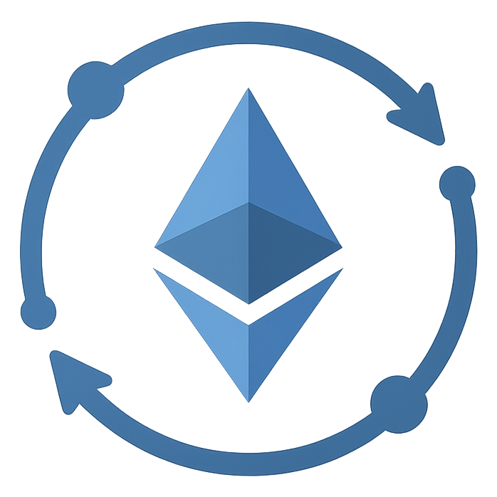

# Syncoor

Syncoor is a sync test orchestation, monitoring and visualization tool that tracks and analyzes Ethereum client synchronization performance by displaying progress charts, peer connections, disk usage, and detailed test results for different execution and consensus client combinations.

<div align="center">
  
</div>

## Overview

To be written...

## Dependencies

- [Docker](https://docs.docker.com/get-docker/) and [Docker Compose](https://docs.docker.com/compose/install/)
- [Kurtosis](https://docs.kurtosis.com/install/)

## Quick start

Using docker compose:

```bash
export KURTOSIS_API_AUTH_TOKEN="$(cat "${XDG_CONFIG_HOME:-$HOME/.config}/kurtosis/api-auth-token")"
docker compose up -d
```

Kurtosis 1.23.0 and newer require an auth token on the engine. The `syncoor-run` container cannot read the token file the Kurtosis CLI keeps on the host, so it is passed through `KURTOSIS_API_AUTH_TOKEN`. On macOS the file is at `~/Library/Application Support/kurtosis/api-auth-token`.


Open [http://localhost:10002](http://localhost:10002) in your browser to view the web UI.


## License

This project is licensed under the [GNU GPL-3.0](LICENSE).
